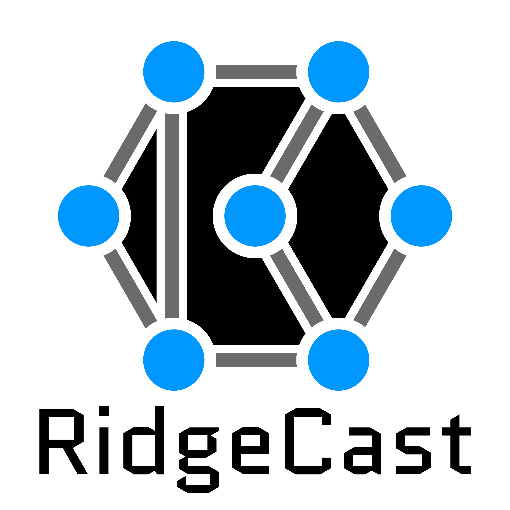

  

# RidgeCast documentation

RidgeCast is a desktop application for planning radio and mesh networks against
terrain, land cover, and other public geospatial data. It can help answer
practical questions such as whether two sites are likely to communicate, where
a radio may provide usable coverage, and how a site failure affects a network.
Terrain and land cover are map data the application uses as inputs to those
predictions. Choose the kind of help that matches what you are doing now.

Open this index from **Help → User Guide** in the desktop. **Help → Getting
Started** opens the first-network tutorial; **Help → Glossary** explains terms.

## Learn RidgeCast

Start here if this is your first time using the application.

- [Visual tour](visual-tour.md) — see the desktop map, coverage color settings,
  and radio system profiles in a synthetic demonstration.
- [Plan your first network](tutorials/plan-your-first-network.md) — use the
  supplied sample to inspect a radio path, map predicted coverage, and check
  whether sites can reach a designated network center. Start here even if you
  have not used radio-planning software before.

## Complete a task

These guides assume that you are already familiar with RidgeCast and want to
accomplish a particular job. If a guide uses an unfamiliar RF or geospatial
term, open the [glossary](glossary.md); the tutorial is the better first stop
when you need a guided tour of the interface.

- [Install and run RidgeCast](how-to/install-and-run.md)
- [Create and configure a network](how-to/create-and-configure-a-network.md)
- [Propose a repeater chain](how-to/plan-a-repeater-chain.md)
- [Import a Radio Mobile network](how-to/import-radio-mobile-network.md)
- [Evaluate a radio link](how-to/evaluate-a-radio-link.md)
- [Generate and export a coverage map](how-to/generate-and-export-coverage.md)
- [Find and validate a candidate site](how-to/find-and-validate-a-site.md)
- [Analyze network resilience](how-to/analyze-network-resilience.md)
- [Use FCC amateur-license data](how-to/use-fcc-amateur-data.md)
- [Work offline and manage cached data](how-to/work-offline-and-manage-caches.md)
- [Register local terrain, surveyed surfaces, and global land cover](how-to/register-local-raster-sources.md)
- [Acquire constrained WorldPop tiles and publish a mirror](how-to/publish-a-worldpop-mirror.md)
- [Import vector overlays and export GIS data](how-to/import-overlays-and-export-gis.md)
- [Drive RidgeCast from an AI assistant](how-to/drive-ridgecast-from-an-ai-assistant.md)
- [Troubleshoot RidgeCast](how-to/troubleshoot.md)

## Look something up

Use these pages while working in the application.

- [Controls and shortcuts](reference/controls-and-shortcuts.md)
- [Display units](reference/display-units.md)
- [Nodes and systems](reference/nodes-and-systems.md)
- [Map views](reference/map-views.md)
- [Propagation settings](reference/propagation-settings.md)
- [Optional scientific CPU models](reference/scientific-models.md)
- [Co-channel interference scenarios](reference/interference-scenarios.md)
- [Coverage modes](reference/coverage-modes.md)
- [Network-analysis commands](reference/network-analysis.md)
- [Files and interchange formats](reference/files-and-formats.md)
- [Data sources and caches](reference/data-sources-and-caches.md)
- [Natural Earth water mask provenance](reference/water-mask-provenance.md)
- [Glossary](glossary.md)
- [Model limitations](reference/model-limitations.md)
- [MCP server](reference/mcp-server.md)

## Understand the models

These conceptual guides explain what RidgeCast computes and why.

- [Choosing a propagation model](concepts/propagation-models.md)
- [Clutter, LiDAR, and canopy density](concepts/clutter-and-lidar.md)
- [From transmit power to fade margin](concepts/link-budget-and-noise.md)
- [Coverage maps](concepts/coverage.md)
- [Finding sites](concepts/site-finder.md)
- [Network analysis](concepts/network-analysis.md)
- [Propagation model decisions](propagation-model-decisions.md) — engineering
  rationale and implementation history for maintainers.

## Project documentation

- [Contributing](../CONTRIBUTING.md)
- [Security policy](../SECURITY.md)
- [Threat model](security/THREAT_MODEL.md)
- [Collaborative review protocol](review/REVIEW_PROTOCOL.md)
- [Screenshot capture checklist](screenshots/README.md)
