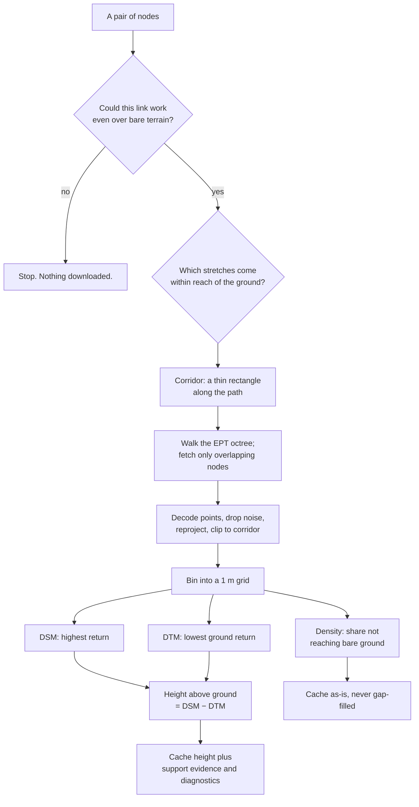

# Clutter, LiDAR, and canopy density

*An explanation of what sits between two radios, why RidgeCast cares, where the
data comes from, and what it does with it. Written for someone who has never
seen the code and does not need to.*

---

## 1. The question every link asks

Point two radios at each other. Will they hear each other?

Some vocabulary, used consistently from here on. A **node** is one radio
installation — an antenna at a place, at a height. A **link** is a pair of nodes
being evaluated against each other. ("Site" and "terminal" mean the same as
node; the application uses all three in different corners of its interface.)

The distance matters, and the transmitter's power matters, but the thing that
usually decides the answer is **what is in the way**. A hill. A ridge. A stand
of Douglas fir. A row of houses. Radio does not simply stop at an obstacle — it
bends around it, punches through it, and bounces off it, all at once — but every
one of those routes costs signal, and predicting a link means predicting that
cost.

So the whole job is: *describe the ground between two nodes accurately enough
that the physics can be applied to it.*

### A note on decibels

Loss is quoted in **decibels (dB)**, and one property of that scale drives
everything below: it is **logarithmic**. Every 10 dB is another factor of ten in
power. 20 dB is a hundredfold, 30 dB a thousandfold, 60 dB a millionfold.

The consequence that matters here is that **dB add up along a path while powers
multiply**. If crossing vegetation costs some number of dB per meter, then
doubling the distance through it doubles the dB — and squares the power
reduction. A rate that sounds trivial per meter becomes decisive over a few
hundred meters, which is why §3's per-meter figures deserve the care they get
there.

## 2. Terrain versus clutter

RidgeCast splits everything between the antennas into two categories, and the
split matters more than it might sound.

**Terrain** is the bare earth — the shape of the ground with everything removed.
Hills, valleys, the slope of a ridge. Terrain is *opaque*. A mountain does not
let a signal through it. What a signal does at a mountain is bend over the top,
losing strength as it goes, which is a well-understood calculation called
diffraction.

**Clutter** is everything standing *on* the ground: trees, buildings, hedges,
crops. Clutter is **not** opaque, and this is the crucial difference. A forest is
mostly air with trunks and branches in it. A suburb is mostly air with houses in
it. A signal crossing 200 m of woodland does not stop — it arrives weakened,
roughly in proportion to how much wood it actually passed through.

### Why the distinction is worth this much fuss

Software of this kind often adds clutter height onto the terrain profile —
treats the treetops as if they were the ground — because it is easy and it looks
reasonable. It is catastrophically wrong.

RidgeCast has a worked case on record: a real 911 MHz link near Kent,
Washington, running 600 m between antennas 10 m and 8 m above ground. This link
is usable in practice. Three ways of predicting it:

| Treatment | Predicted loss | What it means |
| --- | --- | --- |
| Free space — as if nothing at all were there | 87.2 dB | A floor. Not the truth, but nothing real can beat it. |
| Clutter added onto terrain, treated as a solid ridge | 148.4 dB | 61 dB worse than the floor. |
| Bare terrain plus traversal loss (what RidgeCast does) | agrees with an Okumura-Hata suburban estimate | An independent, long-established empirical model. |

Be careful about what the 61 dB is. It is the gap between the naive treatment
and the free-space *floor*, not the error against a measured value — there
genuinely is clutter there, so some loss above free space is correct. But 61 dB
is a factor of over a million in power, on a link that works, and no plausible
600 m suburban path loses that much. The naive treatment is not slightly
pessimistic; it is describing a different world.

So RidgeCast keeps the terrain profile bare, and charges clutter as a separate
**traversal loss**: signal lost by crossing the stuff, rather than by being
stopped by it.

### Two ways past a tree

A signal meeting a tree has two routes, and it takes both:

1. **Through** — arriving attenuated, weakened in proportion to how much
   vegetation it crossed.
2. **Over** — diffracting across the top of the canopy, exactly the way it would
   over a ridge.

**If route 2 sounds like the thing just condemned, that is the crux.** The error
was never in *computing* diffraction over the canopy — that calculation is
correct and necessary. The error was making it the **only** available route, so
that every signal was forced over the top of every tree. RidgeCast computes both
routes and lets them compete.

They are combined **in power terms**: each loss is converted back to a power, the
powers are summed, and the result converted to dB. In practice a route 10 dB
worse than its rival contributes about 9% of the total, and one 20 dB worse
contributes about 1% — so the cheaper route dominates, without the abrupt
switching that simply taking the minimum would produce. This is what the physics
does:

- **Scattered trees over open ground.** Pushing through costs a few dB and wins.
  The canopy never behaves like terrain, which is the failure mode above.
- **Continuous 60 m fir with the antennas underneath it.** Pushing through is
  hopeless, so going over the top is what actually carries the signal — and the
  diffraction geometry decides the answer, as it should. (Reaching that route
  costs extra: a node buried under canopy is charged for climbing vertically out
  of it first, or a radio under sixty meters of fir would look identical to one
  on a mast.)

### The ceiling on the "through" route

The through route does not accumulate without limit. It follows a saturating
curve that approaches **30 dB** and never exceeds it.

The *shape* is well-founded: past a few tens of dB, the energy arriving beyond a
forest has diffracted around and over it rather than penetrated it, so continuing
to extrapolate penetration loss stops describing anything real. Capping one route
while explicitly computing the other is a consistent pair of statements rather
than a contradiction — the cap says "penetration stops explaining this," and the
over-the-top calculation supplies what does.

The *specific value* of 30 dB is an engineering judgement, not a derived
constant, and worth reading as such. In practice it is approached rather than
struck: at the along-path rates in §3, saturation requires several hundred meters
of continuous dense forest.

## 3. Where the data comes from

Three public sources answer three different questions.

| Source | Question it answers | Resolution |
| --- | --- | --- |
| **DEM** (digital elevation model) | Where is the bare ground? | ~10 m (USGS 3DEP) or ~30 m (Copernicus GLO-30) |
| **NLCD** (National Land Cover Database) | What *kind* of stuff is standing here? | 30 m |
| **LiDAR** point clouds | How tall is it, and how much of it is there? | Sub-meter |

These are not three isolated capabilities — LiDAR could in principle supply
ground elevation too, and §4 explains why RidgeCast deliberately refuses to let
it. But each answers its question better than the others do, and no two of them
substitute cleanly.

### DEM — the shape of the ground

A grid of ground elevations. In the United States RidgeCast defaults to the USGS
3D Elevation Program's 1/3-arcsecond tiles, roughly 10 m per pixel; elsewhere it
uses the ESA Copernicus 30 m global DEM. This is the authoritative bare-earth
terrain and nothing else is allowed to overwrite it — see §4.

### NLCD — what things are made of

A 30 m grid where every pixel carries a class: *Evergreen Forest*, *Developed,
Medium Intensity*, *Open Water*, *Cultivated Crops*, and so on. It does not say
how tall anything is or how dense it is; it says what *category* of thing is
there.

That matters, because the material determines how strongly something attenuates
radio. RidgeCast maps each class to a **material rate**: forest classes 1.0 dB
per meter, dense urban development 1.5, low development and scrub 0.5, open water
and bare rock 0.

**These are *vertical* rates, and a path does not use them directly.** They
describe a signal climbing straight up out of the stuff — a few meters of
genuinely solid canopy. A signal crossing a suburb *horizontally* spends most of
its distance in air: between trunks, over roofs, along streets. Charging the
vertical rate for hundreds of meters of that would saturate any ceiling
immediately. So **along a path RidgeCast charges one tenth of the vertical
rate.** Every horizontal figure in this document already has that tenth applied;
only the vertical climb out of clutter at a node uses the full rate.

NLCD also carries an *assumed* density per class — how much of a typical pixel of
that class is actually solid. Evergreen Forest is assumed 85% full; Developed,
Medium Intensity 70%; Shrub/Scrub 20%; grassland 0%. The charge per meter is the
product:

```
along-path attenuation  =  material rate  ×  density  ÷  10
```

For evergreen forest: 1.0 × 0.85 ÷ 10 = **0.085 dB/m**. For medium-density
development: 1.5 × 0.70 ÷ 10 = **0.105 dB/m**. Crossing 200 m of that forest
accumulates about 17 dB, which §2's saturating ceiling then compresses to about
13 dB — significant, survivable, and nothing like the 170 dB the undivided
vertical rate would imply.

Those two figures sit inside the 0.08–0.12 dB/m that ITU-R P.833 — a
recommendation of the International Telecommunication Union's radio arm, the body
that publishes the standard reference models for this field — measures through
woodland at 1 GHz. In fairness, that agreement is a **calibration** rather than
an independent confirmation: the factor of ten was chosen partly *because* it
lands the result there. It is a sanity check that the model is in the right
regime, not proof arrived at from first principles.

Two things this does **not** account for, both of which reappear in §6:

- **Frequency.** The material rates carry no frequency term, while the ITU
  figure that calibrates them is specifically at 1 GHz. Vegetation loss really is
  frequency-dependent, so the model is on its firmest ground near 1 GHz and
  progressively less so away from it.
- **Reality.** The assumed densities are *assumptions about a category*, not
  observations of a place. **They are the weak link**, and replacing them is what
  §5 is about.

### LiDAR — actual measurement

Everything above is inference from categories. LiDAR is measurement.

An aircraft flies over with a downward-pointing laser, firing hundreds of
thousands of pulses per second. Each pulse travels down, hits something, and
bounces back; the round-trip time gives the distance, and combined with the
aircraft's position that gives a 3-D coordinate. Do this across a whole state and
you get a **point cloud**: billions of individual measured points, typically 2 to
8 of them per square meter of ground.

Two properties make this far more useful than it first appears.

**Pulses penetrate.** A laser pulse hitting a tree does not necessarily stop at
the first leaf. Part of it reflects off the canopy top, part carries on through
gaps, hits a branch, reflects again, and part may reach the ground. One pulse
therefore produces *multiple returns* at different heights. Over a car park you
get one return per pulse, off the tarmac. Over dense forest you get several, and
often none of them reach the ground at all.

**Points are classified.** Whoever processed the survey has already labelled each
point with what it hit, using a standard scheme: class 2 is bare earth, class 9
is water, classes 3–5 are vegetation by height, class 6 is buildings, and classes
7 and 18 mark noise — birds, cloud reflections, and stray points below ground.

RidgeCast uses USGS 3DEP and NOAA coastal acquisitions, and decodes the files
natively in Rust — there is no PDAL, LAStools, or Python environment to install.

Withheld returns, noise classes 7 and 18, and invalid coordinates or elevations
are excluded before reconstruction and return-density counts. Synthetic and
overlap flags alone do not exclude a valid return.

## 4. Getting LiDAR from a national archive onto one link

A national point cloud is measured in *terabytes*. A link needs a strip of ground
a few meters wide. Almost all of the engineering here is about not downloading
the rest.

### Two gates, before anything is fetched

**Gate one: could this link work at all?** Clutter only ever *adds* loss. A pair
that already fails over bare terrain cannot be rescued by anything a survey would
reveal, so it is dropped before it becomes a download.

**Gate two: which stretches could actually matter?** A long link only exists
between two nodes that are already high, which means most of its path is far
above anything on the ground. RidgeCast keeps only the stretches where the signal
comes within reach of the ground, judged along a clearance profile sampled every
100 m. A stretch is kept when the ray clears bare terrain by less than:

- **120 m** — the tallest thing a measured surface is asked to represent. For
  scale, the categorical model tops out at 25 m for evergreen forest and 20 m for
  dense development, so this is already several times the clutter this ground is
  modeled as carrying. It rises to **400 m** under dense urban land cover,
  because a city center is the one place a structure genuinely stands far above
  what land cover predicts.
- **plus the Fresnel radius** — the cigar-shaped volume around the direct line
  that carries most of the energy. Clutter outside it does not obstruct, so its
  radius is part of the reach that must be cleared.
- **minus the earth's bulge.** Over tens of kilometers the ground curves up
  relative to a straight line, reducing real clearance. RidgeCast subtracts that
  bulge, computed at the standard 4/3 effective earth radius that accounts for
  atmospheric refraction bending signals slightly downward.

Both ends are always kept, and each retained stretch is widened by one clearance
sample — about 100 m — at either end, because a gate that is wrong is far more
expensive than a gate that is generous. The upshot: **a path that clears
everything along its length downloads no point cloud at all beyond its two
ends.**

### Fetching only the right points

Survey selection follows the requested stretches of a link, or the requested
node footprint. A survey gap in a skipped stretch does not reduce the reported
coverage of the requested ground. Extra context around a node can add nearby
surveys without counting that optional margin as missing coverage. Coverage is
estimated with bounded probes; it does not guarantee a measured return in every
surface cell.

Where surveys overlap, the newest acquisition takes priority. Holes in its
published boundary remain holes, so an older survey can supply their coverage.
Catalog selections are cached for the requested geometry and provider; enlarging
a footprint or changing the requested stretches triggers a new selection. If a
catalog item times out, the successful portion stays available offline and
discovery is retried online rather than treating the partial answer as complete.

Point clouds are published as **EPT** (Entwine Point Tile) — an octree. Picture
the dataset as a cube, split into eight sub-cubes, each split again, and so on.
Coarse levels hold a thin scattering of points across a wide area; deeper levels
hold dense points over small areas. A web-addressable index describes the tree.

RidgeCast walks that tree and fetches only the nodes overlapping the corridor
*polygon* — not its bounding box, which for a diagonal path would be enormously
larger. It stops descending once the level is fine enough for the requested cell
size, so it never pays for precision it will not use. If a corridor would still
require too many octree nodes, it steps back a level and accepts a sparser cloud
rather than refusing the link.

Downloaded files are kept on disk exactly as served, because neighbouring
requests reuse them heavily — one neighbourhood generated 78 separate prepared
areas from a few dozen shared source files.

### Output grid and source detail

A **1 m DSM grid** means one output cell per metre. It does not guarantee that
LiDAR returns are spaced one metre apart. RidgeCast chooses the EPT hierarchy
level in ground metres, converting geographic degrees, correcting Web Mercator
for the scene latitude, and accounting for UTM scale. Turning a link does not
change that physical spacing estimate. It is a nominal sampling measure, not
survey accuracy or a promise of observed ground in every cell.

Status records the requested grid, selected hierarchy depth and nominal spacing,
and the finest populated level actually found. A sparse survey can stop above
the requested level. These details remain attached to a cached surface, so a
warm calculation reports the source detail that produced it.

Each requested surface and acquisition has its own limit of **4,096 populated
EPT nodes**, including coarser ancestor nodes that contribute additional returns.
If needed, selection becomes up to three levels coarser and reports that choice.
Combining several requests for download does not make their source data coarser
merely because the combined total exceeds that limit. The output grid itself
stays at the requested spacing.

Planning includes the wider context prepared for a cache miss and fixes the
catalog and node selection for that calculation. Downloads, per-node readiness
and preparation use those same dependencies; a tile from one survey cannot
complete another survey's progress. Later cache or catalog changes affect a new
calculation. Short requests crossing the international date line keep a compact
footprint for planning, cache reuse and status probes.

### From points to a grid

Individual points are awkward to work with: there are enormous numbers of them,
they are irregularly spaced, and answering "how tall is it *here*" means
searching. So RidgeCast bins them into a grid, by default 1 m per cell.

Withheld returns and noise classes 7 and 18 are discarded first. Invalid
coordinates, nonfinite elevations, elevations outside Float32 range, and
elevations that equal or round to the internal −9999 m missing-value marker are
also excluded before classification or counting. The adjacent representable
elevations remain valid. These filters apply equally to DSM, DTM, and diagnostic
return counts. This matters more than it sounds,
because the two surfaces below are a maximum and a minimum — the two statistics
most easily wrecked by one stray point. A single uncorrected bird would become a
building.

Each surviving point is reprojected from the survey's own coordinate system into
a local meter-based frame, checked against the corridor, and folded into three
tallies for the cell it lands in:

- **DSM** (digital surface model) — the *highest* return. Treetops, rooftops, or
  the ground where nothing stands on it.
- **DTM** (digital terrain model) — the *lowest ground-classified* return. Bare
  earth, including the ground beneath a canopy wherever a pulse found its way
  down. The minimum rather than an average because ground returns that are too
  *high* are the realistic error — a low branch misclassified as ground — while
  points below true ground have already been removed as noise.
- **Density** — how many returns landed here, and how many reached a bare
  surface. §5 is entirely about this one.

Subtract the two surfaces and you get what the model wants: **height above
ground = DSM − DTM**, cell by cell.

### Filling the holes

Real surveys have gaps. Under dense canopy no pulse reaches the ground, so there
is a DSM value with no DTM beneath it — and no ground means no height. Under a
large building it is worse: the roof blocks everything.

RidgeCast fills these with a local average over neighbouring cells, run much
harder on the ground surface than on the top: a 5×5 window in one pass for the
top surface, against a 9×9 window in three passes for the ground. Then, for
ground only, it bridges runs of missing cells bracketed by real ground
values on both sides, up to a 300 m span. Those endpoints can themselves be
locally filled. The support record therefore retains an inherited distance bound
back to contributing original cells; the conservative policy checks that bound,
not just the length of the last filled gap.

The asymmetry is deliberate. Bare earth is smooth and continuous, so estimating
it between nearby measurements can preserve buildings and canopy heights, but
remains an inference rather than a direct measurement. A canopy top is neither,
and smearing it would
invent obstacles that are not there or erase ones that are.

The *height* surface is filled. The *density* surface deliberately is not — §5
explains why.

### Choosing how much ground evidence to require

**LiDAR ground policy** in propagation settings controls when reconstructed
height replaces categorical clutter. New settings use **Conservative v1**.
It accepts class-2 ground observed in the cell, or ground inferred from
classified returns whose inherited source-cell distance bound is at most 300 m.
The top surface must be observed or locally filled within two diagonal cell
steps (plus 0.1 m for upward distance rounding). Bounded interpolation under a
building remains usable; a distant or unsupported ground estimate does not.

**Legacy minimum return v1** retains the earlier estimator: if an acquisition
has no accepted classified ground, its minimum accepted return estimates DTM,
including subsequent gap filling. This is useful compatibility behavior, but
roof-only or canopy-only returns cannot establish the true bare earth. For
example, one unclassified return at 20 m yields DSM = estimated DTM = 20 m and
an estimated obstruction of **0 m**. Conservative mode retains a configured
categorical **20 m** height there; legacy mode replaces it with **0 m**. A real
classified ground return with DSM = DTM is a supported zero and replaces the
categorical height with zero in both modes.

Both policies reject cells overlapping a failed source region and cells whose
inference depends on such a region. An unusable newer acquisition does not hide
usable older support: selection continues through the ordered crops and
acquisitions before falling back to categorical clutter. DSM and DTM are always
paired from the same acquisition. Open water and permanent ice retain their
categorical heights regardless of LiDAR evidence.

Existing saved configurations with an explicit `itm_dsm` object but no
`ground_policy` preserve **Legacy minimum return v1**. Configurations without
that object keep both DSM scopes disabled and get the new conservative policy
if enabled later. Saving writes `conservative_v1` or
`legacy_minimum_return_v1` explicitly. Changing policy changes predictions and
their cache identity without rebuilding point clouds or support rasters;
running calculations continue using their captured policy.

**Details at Point** and headless point reports expose the raw estimate and
its ground/surface methods, direct return counts, immediate donor-cell count,
source-distance bounds and policy rejection reason. Counts of 255 mean **255
or more**, not exactly 255. Donors are cells, not independent laser pulses.
Distances round upward to 0.1 m and bound original cell centers, not laser range
error or statistical confidence. Profile status counts observed, inferred,
estimated, rejected and missing support at centerline probes. These probes
summarize availability; actual RF composition also samples the corridor strip
and terminal neighborhood. Cache totals count stored cells, including overlaps,
not unique geographic area or the fraction of a provider catalog downloaded.

### What is kept

Before a network link or node coverage run fetches LiDAR, the calculation
dialog estimates the disk space for its point clouds and compiled surfaces.
The point-cloud estimate uses the public EPT hierarchy's point counts and the
sizes of tiles already cached. The surface estimate counts each new surface
once using its actual crop orientation, raster resolution, and acquisitions,
before compression. These are planning estimates, so actual file sizes vary.
The dialog shows each configured cache limit beside the estimate. If either
working set is much larger than its limit, a warning also appears in the status
bar. Point-cloud eviction can force repeated downloads and may prevent a run
from finishing; surface eviction can force rebuilding in later calculations.
Cancel the run, then raise the relevant LiDAR cache limit or reduce the area or
DSM resolution before trying again.

Storing two floating-point surfaces per cell was extravagant, and only their
difference was ever read. RidgeCast stores the height above ground directly, as
**one byte per cell**, in steps of 0.6 m — eight times smaller than the pair it
replaced. One real cache had accumulated 87 GB of prepared surfaces built from
only 34 GB of downloaded point clouds, which is plainly the wrong way round.

One byte gives 256 values. One is reserved as a sentinel meaning "nothing was
measured here", which is deliberately distinct from a measured height of zero —
open ground overrides the categorical estimate, whereas an unmeasured cell keeps
it. That leaves heights up to about 152 m, and anything taller saturates there
rather than wrapping around, so a skyscraper stays the tallest thing on the path
instead of reappearing as open ground.

Diagnostic return density is a second byte with the same sentinel convention.
An **eight-byte support record** per full-resolution cell retains ground and
surface methods, direct counts, donor count, source-distance bounds and failed
source flags. The uncompressed full-resolution payload is therefore **10 bytes
per cell**, plus four bytes per ground cell decimated by eight on each axis.
Each support plane adds a 48-byte header. TIFF headers, manifests and compression
also affect disk size. Decoded pixel accounting includes the full support
records; reconstruction additionally needs DSM, DTM, return tallies and bounded
fill scratch. A 10 × 10 crop at 1 m has 1,016 decoded sample bytes and 1,064
uncompressed sample bytes including its support header, before TIFF/manifest
overhead. The decimated ground exists for diagnostic elevation and hillshade;
it never replaces the authoritative DEM in RF propagation.

Support and source-failure provenance are mandatory in cache format 6. Missing, corrupt, misaligned or
semantically inconsistent sidecars make the derived surface a cache miss.
Older derived cache formats are rebuilt using reusable raw LAZ inputs rather
than treating old numeric heights as observed ground.

The current ground rasters retain the crop's upper-left corner as their GeoTIFF
tiepoint. An 8-by-8 block of one-meter cells has its ground sample at the block
center, four meters inward; partial edge blocks retain that same grid. This
corrects shifted ground sampling without shifting the obstruction-height grid.

Preparation checks a byte allowance before allocating raster planes. The check
includes support and return counts, interpolation scratch, native codec and
metadata storage, rollback state, output compression, and already retained
surfaces and frozen source selections. Native point clouds are decoded once in
chunks of at most 4,096 accepted points. A failed source node rolls back all its
chunks, including any change to the acquisition's classified-ground state.
Encoded input is admitted as it grows, including both allocations during buffer
growth; small sources do not reserve the maximum download size. Local LAS/LAZ
files are streamed into a private temporary file before validation, so external
edits cannot change allocation metadata during decoding. This uses temporary
disk space equal to the source file's initially observed size and adds one
encoded read/write pass. Point decoding still happens once.
If preparation cannot fit, it reports a surface memory limit and leaves the
unavailable cells on categorical clutter. Diagnostic return density remains
available, while RF attenuation continues to use categorical material density.

### Incomplete sources and recovery

A downloaded point-cloud file is a candidate until native LAS/LAZ decoding
finishes. If a cached candidate is corrupt, RidgeCast invalidates that exact
payload and allows one replacement download. A corrupt replacement or an
ordinary provider failure remains explicit and retryable on a later preparation.
A valid file with zero accepted points is an empty success, not corruption.
Work Offline, cancellation, and resource refusal stop a new build. Already
prepared partial surfaces remain available in cache-only and offline use.

Successful nodes and independent acquisitions can still supply useful support.
The prepared report retains failed acquisition/node identities, error stages,
and conservative regions where point contributions may be missing. Those
regions can include surviving observed returns: a missing node might have
contained a higher roof or a lower ground return. Both ground policies reject
such incomplete heights. Interpolation keeps a separate flag when it depends
on an affected donor, including outside the failed region. Another independently
supported acquisition can supply the height; otherwise categorical clutter is
used. Numeric gap filling never establishes observed coverage.

Three coverage quantities answer different questions. Catalog footprint
percentages estimate where survey polygons cover request probes. Stored support
totals count raster cells, including overlapping crops. A result's usable,
observed, inferred, estimated, failed-source, and missing counts describe its
actual **centerline probes**, after the selected policy and acquisition
precedence; they are not geographic area percentages or exact strip/terminal
percentile contributions. Failed-source reports include their coordinate frame.
Exported details are bounded to 16 source reports and 64 failure entries per
report, with omitted counts; prepared metadata retains the full bounded set.

Catalog completeness is separate from footprint coverage. Online preparation
revisits incomplete selections and unresolved source failures, including crops
already in memory or on disk. Complete discovery with a genuine geographic gap
can be reused. If a refresh remains incomplete, an existing useful surface stays
published and available to the current calculation. The attempted refresh's
incomplete-discovery and source-error details remain in that result's diagnostics,
and later online preparations retry. Only a complete refresh replaces that useful
generation; a first partial surface can still be cached when none existed.
Supplied raster heights have no native point-cloud evidence. If a supplied
raster has a retained native fallback, diagnostics still include that fallback's
source report once, even when several supplied surfaces share it. Report regions
use the native crop's coordinate frame; actual supplied and native probe counts
remain separate.
A replacement surface is staged and validated, then its manifest
is published after all new planes are available. An interrupted replacement
preserves the previous usable generation and existing calculations keep their
immutable prepared inputs.

The finer mechanics of gap filling, caching, and storage layout live in the
[decision record](../propagation-model-decisions.md).

### One rule that is never broken

**Measured LiDAR elevations are never spliced into the DEM.** LiDAR could supply
ground elevation — it is exactly what the DTM is — but the two sources use
different vertical reference datums (the agreed zero-height surface a survey
measures against, which is not a single universal definition) and were captured
years apart. Stitching them would create false cliffs at the edge of every
surveyed patch. So the DEM remains the authoritative ground; LiDAR contributes
only *height above* that ground, and NLCD remains authoritative for material.

Where LiDAR is missing the model falls back to categorical NLCD clutter and says
so, rather than treating unsurveyed ground as open air. An unmeasured gap reading
as free space would make an obstructed link look excellent, which is exactly the
class of confidently wrong answer this whole design exists to avoid.

### The pipeline, end to end

Now that the terms are defined:



## 5. Return-density diagnostic

The LiDAR preparation pass stores this per-cell ratio beside obstruction height:

```
return density = 1 − (bare-surface returns ÷ all returns)
```

The byte is useful for inspecting an acquisition, but it is **not used as RF
canopy density**. The available decoded points do not retain pulse identity, and
one laser pulse can produce several canopy returns plus a ground return. Counting
those as independent observations makes the ratio depend on sensor configuration,
return mode, classification, and acquisition processing rather than only on how
closed the canopy is.

For that reason, measured return density does not replace the calibrated NLCD or
WorldCover class density in path-loss calculations. A zero or 100% stored ratio
has no direct attenuation meaning. The raster and profile plumbing remain so a
future pulse-aware, acquisition-normalized estimator can be validated without
changing the surface-cache format again.

Cells with no returns, acquisitions without usable bare-surface classifications,
and areas outside LiDAR coverage use the reserved no-data value. Return-density
rasters are not gap-filled.

## 6. What this does not do

The honest edges, including the ones that limit any future calibrated use of the
diagnostic return ratio.

- **The laser looks down; the signal goes sideways.** Even a pulse-aware vertical
  gap fraction would need calibration before it could describe a horizontal RF
  path through trunks, branches, streets, and roofs.
- **The two instruments disagree about what counts as solid.** A ~1 µm laser
  pulse and a decimeter-wavelength radio wave interact with leaves and branches
  differently. The stored return ratio is therefore diagnostic only.
- **Frequency is not modeled in the traversal term.** Material rates carry no
  frequency dependence, and the ITU figures they are calibrated against are at
  1 GHz. Treat results well away from that with more caution. (Frequency *is*
  used elsewhere — Fresnel geometry and the over-the-top diffraction route both
  depend on it.)
- **Buildings are treated statistically, not structurally.** A house is clutter
  with a categorical density and material rate; there is no model of wall penetration. At
  around 0.105 dB/m, crossing a 10 m building costs about 1 dB, which is
  reasonable as an average over a 30 m suburban pixel and clearly optimistic for
  a signal actually passing through one specific wall.
- **The model uses a path profile.** RidgeCast builds a one-dimensional profile
  along the path and applies established propagation models to it; it does not
  reconstruct individual building surfaces.
- **Material is still inferred.** LiDAR measures geometry, not electrical
  composition. The mapping from land-cover class to electrical properties is an
  assumption, and the application labels it as one wherever it is shown.
- **LiDAR coverage is patchy and dated.** Availability varies by region, and any
  survey is a snapshot from a particular year. A forest logged since the flight
  is still a forest in the data.
- **Return density is not a vertical profile.** A cell knows only the ratio of
  classified returns, not their pulse grouping or how material is distributed
  with height.
- **A coarsened octree walk thins the evidence.** When a corridor is too large,
  RidgeCast drops a level and works from a sparser cloud (§4). Density is a ratio
  of return counts, so fewer returns make it noisier — the subsample is spatially
  even, so it should stay roughly unbiased, but it is a weaker measurement and
  nothing in the output currently distinguishes it.
- **Quantisation is small but not negligible, and worth stating precisely.**
  Height is stored in 0.6 m steps, which is *coarser* than a LiDAR system's raw
  vertical ranging accuracy of roughly 10 cm. What it is far below is the spread
  of the quantity actually stored: a profile vertex is a percentile over hundreds
  of samples across a strip of real, uneven ground, and that summary varies by
  much more than 0.6 m from one vertex to the next. The same argument covers the
  one-percent density step.

## Related reading

- [`docs/propagation-model-decisions.md`](../propagation-model-decisions.md) —
  the engineering decision record, including why each of these choices was made
  and what was tried first.
- [RidgeCast documentation](../README.md) — the settings and task guides that
  turn these scopes on, and
  what they cost in disk and bandwidth.

Registered local DSM/DTM surveys keep their configured priority over public
surfaces. Both ground policies accept valid supplied raster heights: these
products provide a ground surface without native return classifications or
counts. A missing local cell tries the next configured pair, then an already
cached public surface under the selected native ground policy, then categorical
clutter. Each calculation retains its decoded survey rasters, so replacing or
removing a survey affects the next calculation. Both directions of a two-way
coverage run use the same prepared surface context.

Point diagnostics identify `supplied_raster` and `native_lidar` origins. Supplied
products have no native support object; their height does not create class-2
observations or return counts. Profile status counts supplied DSM/DTM probes
separately. Headless point queries and map **Details at Point** use their own
configured pair priority and ground policy. Inspection uses decoded cache data
without acquiring or decoding a missing survey. A rejected native estimate can
remain visible as a raw diagnostic while the policy-usable height is absent.
