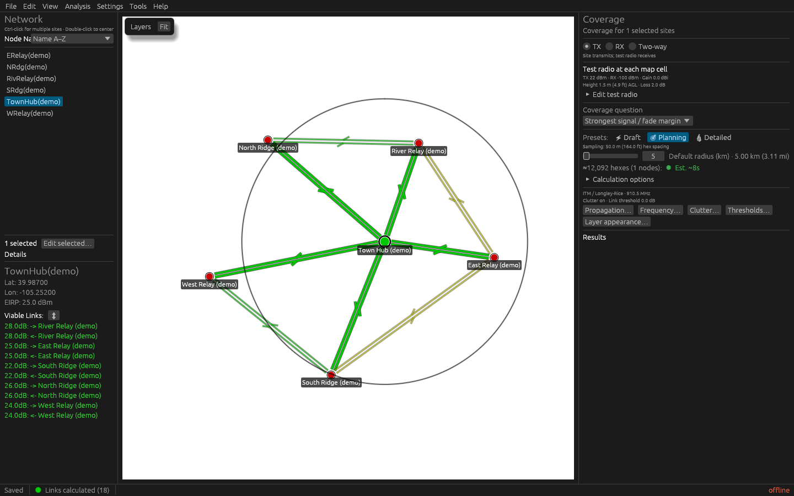

<p align="center">
  
</p>

# RidgeCast

RidgeCast is a native desktop application for planning radio and mesh networks
on a real-world map. Use it to explore whether proposed sites can communicate,
where a radio may provide usable coverage, and how failures affect the rest of
a network. It combines interactive site editing, terrain-aware
propagation, land-cover clutter, coverage maps, FCC amateur-license data,
candidate-site search, network analysis, and GIS interchange in one Rust
application.

It is a planning tool for technically minded users, including people new to RF
planning who are ready to learn the terminology in the tutorial and glossary.

The project is under active development and has not reached a stable 1.0 file
format or modeling API.



Synthetic example with illustrative saved link values. See the
[visual tour](visual-tour.md) for the workspace, Layers drawer, site editor,
radio profiles, and fade-margin controls.

## Highlights

- Keep sites and details in the left Network navigator, coverage assumptions and
  results in the right Coverage workbench, and map styling in a pinnable Layers
  drawer. See [planning workspace controls](reference/controls-and-shortcuts.md#planning-workspace).
  Floating dialogs fit their contents before scrolling; their width stays adjustable.

- Register checked WGS84 bare-earth DEMs, aligned DSM/DTM surveys, and bounded
  ESA WorldCover categorical crops; prepare an explicit offline calculation task
  with disk-backed source readiness. See [local sources](how-to/register-local-raster-sources.md).
- Save and reload retained numeric coverage through MCP as integrity-checked
  `.rccov` artifacts, preserving per-node and directional margins with guarded
  network/model/source identity.

- Place, edit, import, and organize radio nodes with reusable system profiles.
- Save project files explicitly, see unsaved changes in the title and status
  bar, and recover unsaved work from separate per-document snapshots. Protect
  edits when opening, replacing, or closing a document; see
  [saving and recovery](how-to/create-and-configure-a-network.md#save-and-recover-your-work).
- Preserve authored vector layers and undo coverage-control edits. Share
  [portable project bundles](reference/files-and-formats.md#portable-project-bundles)
  with referenced overlays and explicit model assumptions.
- Choose metric or US customary display units; planning controls show the
  equivalent in parentheses. See [Display units](reference/display-units.md).
- Evaluate directional links with terrain profiles, Fresnel clearance,
  persistent network results that reuse unchanged terrain/LiDAR evaluations,
  automated antenna height solving (to achieve ≥60% Fresnel clearance or a
  target fade margin), Longley–Rice/ITM or P.1812-inspired terrain-diffraction
  path loss, link budgets, modeled noise floors, and optional measured LiDAR
  surfaces, with cancellable background preparation and visible measured,
  partial, or categorical status for individual profiles and height solves.
  [LiDAR ground policies](concepts/clutter-and-lidar.md#choosing-how-much-ground-evidence-to-require)
  retain observed/inferred support, offer conservative categorical fallback,
  and preserve an explicit legacy minimum-return estimator.
- Configure explicit ITM ground/climate/polarization and confidence/reliability
  targets; apply optional vertical RF taper or import measured separable antenna
  cuts. See [Antenna responses](reference/nodes-and-systems.md#optional-vertical-response-and-measured-cuts).
- Select the separately validated complete outdoor P.1812-7 CPU backend with
  explicit environmental inputs; prepare offline P.372 atmospheric noise at
  20–30 MHz and run named co-channel SINR scenarios through MCP. See
  [scientific model contracts](reference/scientific-models.md).
- Estimate each site's noise floor from land cover and population: unintentional
  man-made noise (ITU-R P.372), plus tunable in-band traffic seeds and adjacent-band
  receiver desense on shared ISM bands. Override any of it with a measured noise floor.
- Generate multi-node TX, RX, or same-site two-way coverage using CPU calculations or a GPU-assisted
  interactive approximation, with configurable fade-margin thresholds and a
  choice of smooth colors or distinct quality bands. Plan required data across
  the evaluation footprint and calculate ready nodes while other downloads
  continue, with progress that distinguishes data waits from calculations.
- Compare a transmitter's coverage at different antenna heights, show gained
  and lost areas with a height chart, or export an animated GIF.
- Restore saved coverage selections across sessions and reuse completed per-node
  calculations from a configurable disk cache.
- [Find candidate radio sites](how-to/find-and-validate-a-site.md), optionally
  skipping ground your network already covers so sites rank by the coverage they
  would add; refine promising cells, compare added coverage, check and load
  population data, freeze explicit transmitter/receiver assumptions, inspect
  sampled origins, and export ranked CSV/GeoJSON with original scan provenance.
- [Propose a bounded repeater chain](how-to/plan-a-repeater-chain.md) between two selected nodes using a generated corridor or supplied sites/markers, explicit placement exclusions, and bidirectional RF checks; preview sites before adding them.
- Analyze backbone reachability, critical nodes, N-1 failures, best and
  [independent routes](concepts/network-analysis.md#8-is-the-redundancy-real),
  service impact, and multi-hop throughput scenarios.
- Save named analysis assumption profiles, channel/radio plans, directed PHY
  rates and explicit delays; report named critical-facility service and rank
  proposed nodes by independently evaluated resilience, route and facility gains.
  See [network-analysis inputs](reference/network-analysis.md#assumptions).
- Download and query the FCC ULS amateur catalog locally, geocode nearby records,
  and create planning nodes from license entries or single coordinates.
- Bulk-add fully configured nodes from pasted spreadsheets, logs, or coordinate
  lists: tag patterns cover most scalar node settings, and pickers build the pattern
  from your own columns.
  See [bulk-add tags and exceptions](reference/controls-and-shortcuts.md#bulk-add-tags).
- Merge one saved RidgeCast network into another, or import Radio Mobile
  networks and coverage, configured JSON node sources, and KML, KMZ, GeoJSON, or
  GPX vector overlays.
- Export nodes, calculated links, coverage, and overlays as CSV, KML/KMZ,
  GeoJSON, GeoTIFF, PNG, or JSON as appropriate. A coverage image can be
  framed with one click using Fit to Evaluation Range or Fit to Visible Coverage, saved to disk or
  copied directly to the clipboard, and can carry a legend captioning each site
  with the radio and antenna parameters you choose, laid out as one box or as
  per-site callouts and placed automatically where it hides the least coverage.
  The legend can also report how much land area and population the coverage
  reaches, as a whole-image stats card, per site, or both.
- [Drive the engine from an AI assistant](how-to/drive-ridgecast-from-an-ai-assistant.md)
  through the MCP executable included beside the desktop in Windows release packages: query terrain, evaluate links, check the signal at an
  address, search for candidate sites, and propose repeater chains without a window.
- Cache terrain, land cover, LiDAR, population, FCC, geocoding, basemap, and
  calculation data for reuse and offline work. Select a geographic region to
  prefetch terrain and land cover and inspect its cache availability before
  disconnecting.
  Test individual terrain and population sources in Mirror Preferences with
  fresh sample downloads that stop after the first valid raster.
- Show the basemap through oceans and lakes in the terrain overlay, using an
  offline worldwide water mask while preserving land below sea level.
  See [Terrain overlay and water](reference/controls-and-shortcuts.md#terrain-overlay-and-water).
- Estimate population using WorldPop 2020 UN-adjusted constrained country tiles.
  [Acquire tiles and publish a mirror](how-to/publish-a-worldpop-mirror.md)
  with `tools/Download-WorldPop2020.ps1`, `tools/Upload-CloudflareR2.ps1`, or
  `tools/Publish-WorldPopRelease.ps1`, or let RidgeCast download them on demand.

## Documentation

- **New user:** [Plan your first network](tutorials/plan-your-first-network.md)
  with the sample data in the source checkout.
- **Find radio sites:** [Find and validate candidate sites](how-to/find-and-validate-a-site.md)
  with Site Finder, or read [how Site Finder scores ground](concepts/site-finder.md).
- **Complete a task:** Browse the [how-to guides](README.md#complete-a-task).
- **Look up a control or format:** Browse the
  [reference pages](README.md#look-something-up).
- **Understand the models:** Read the
  [conceptual guides](concepts/README.md).
- **All documentation:** Start at the [documentation home](README.md).

## Build and run

Windows release tooling supports portable ZIPs and per-user installers containing
desktop, MCP and offline documentation. **Help → Check for Updates** provides
requested signed-release discovery and explicit installation when a trusted key
is pinned into the build. See [package installation and updates](how-to/install-and-run.md).

Building from source requires Rust 1.93 or
newer, Git, a C++17 compiler, and a desktop graphics environment with WebGPU
support.

First download or clone this repository, then open a terminal in its top-level
directory (the directory containing `Cargo.toml`). Run:

```bash
cargo run --release
```

This command launches the desktop application. To build and run the MCP server
from source, follow [the assistant setup guide](how-to/drive-ridgecast-from-an-ai-assistant.md).
The first build compiles the Rust application and bundled C++ ITM
implementation. No API keys are required for the built-in public data sources.
Internet access is needed when required data is not already cached.

See [Install and run RidgeCast](how-to/install-and-run.md) for
platform prerequisites and troubleshooting.

## Project status and safety

RidgeCast is best suited to technical users who are comfortable validating RF
assumptions and managing downloaded geospatial data. Its output is a planning
aid, not a substitute for a field survey, regulatory review, safety analysis, or
coordinated frequency plan.

Terrain, land cover, public records, propagation models, antenna approximations,
and environmental-noise estimates all have important limitations. Read the
[model limitations](reference/model-limitations.md) before relying on a
plan, and validate regulatory or safety-critical predictions independently.

Downloaded or queried data may disclose the geographic area being studied to
the selected public providers. **Work Offline** blocks outbound requests while
leaving cached data available. See [Data sources and caches](reference/data-sources-and-caches.md)
for providers, storage locations, privacy behavior, and cache policy.

## Development

Run the standard checks before submitting a change:

```bash
cargo check
cargo fmt --all -- --check
cargo clippy --all-targets --all-features -- -D warnings
cargo test
pwsh -File tools/check-doc-links.ps1
```

Some tests download public terrain data and may be skipped in offline or
restricted environments as described in [CONTRIBUTING.md](CONTRIBUTING.md).

Repository layout:

```text
src/app/             Application state, actions, persistence, and egui windows
src/engine/          Propagation, terrain, land cover, LiDAR, and Site Finder
src/graph/           Network models, routing, and Radio Mobile import
src/map/             Basemap and raster-overlay rendering
cpp/                 Bundled C++ ITM implementation and CXX wrapper
docs/                User, model, security, and project documentation
example-rm-imports/  Small Radio Mobile import examples
```

See [CONTRIBUTING.md](CONTRIBUTING.md) for contribution expectations,
[SECURITY.md](SECURITY.md) for vulnerability reporting, and
[THIRD_PARTY_NOTICES.md](THIRD_PARTY_NOTICES.md) for bundled component provenance
and terms.

## License

RidgeCast is All Rights Reserved; see [LICENSE](LICENSE). Bundled third-party
components remain subject to their own licenses and notices.
