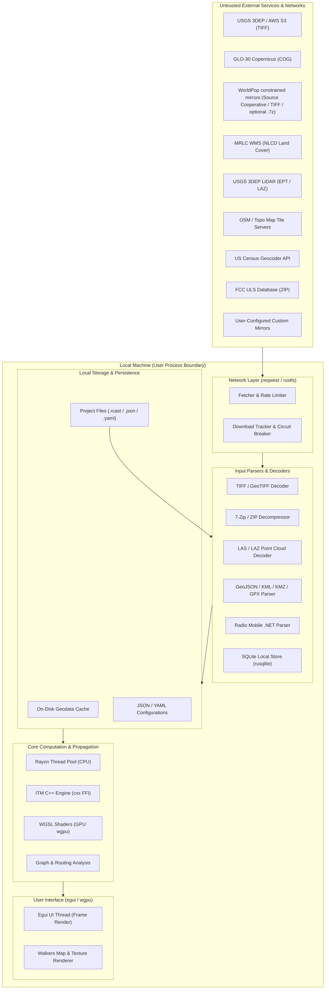

# RidgeCast — Threat Model

**Version**: 1.0  
**Date**: 2026-08-25  
**Scope**: RidgeCast Desktop Application (`src/`, `cpp/`, assets, external data pipelines, and local caching)  
**Methodology**: STRIDE + OWASP Threat Modeling Framework  

Configured geodata and population mirrors have an HTTPS-only policy. Other
network URL classes are handled by their individual callers; controls listed
for mirrors do not automatically apply to them. This assessment reflects the
code reviewed on the date above.

---

## 1. System Description & Architectural Context

RidgeCast is a cross-platform desktop application written in **Rust** (with **egui** for immediate-mode UI and **wgpu** for hardware-accelerated compute/rendering) designed for RF network planning, terrain profile analysis, and Longley-Rice / ITM propagation modeling.



---

## 2. Assets & Sensitivity Classification

| Asset | Sensitivity | Description | Impact of Compromise |
|-------|-------------|-------------|----------------------|
| **RF Mesh Topology & Coordinates** | Medium | Tower/node locations, frequencies, power levels, antenna patterns. | Competitive/tactical intelligence disclosure. |
| **FCC ULS Amateur Radio Records** | Low–Medium | Names, callsigns, physical mailing addresses, license status. | PII exposure if cached insecurely on multi-user systems. |
| **Geospatial & Elevation Cache** | Low | Multi-gigabyte cached DEM rasters, LiDAR point clouds, land cover tiles. | Integrity tampering leading to erroneous link planning; local disk exhaustion. |
| **Application Integrity & Memory** | High | Rust process heap, C++ FFI memory space, GPU shader execution context. | Arbitrary code execution or system compromise via crafted inputs. |
| **Configuration Files** | Low | Mirror endpoints, window geometry, RF defaults. | Misdirection to malicious mirrors if tampered with. |

---

## 3. Threat Actors & Attack Vectors

1. **Remote Network Adversary / Malicious Mirror Provider**:
   - Operates a rogue geodata mirror or executes Man-in-the-Middle (MITM) attacks against unencrypted HTTP endpoints.
   - Motivations: Feed falsified elevation/population data to disrupt RF designs, execute denial of service via oversized payloads, or exploit decompression parsers.
2. **Untrusted Project / Vector File Creator**:
   - Authors malicious project files (`.json`, `.yaml`, `.rcast`), vector layers (`.kmz`, `.kml`, `.geojson`, `.gpx`), or Radio Mobile networks (`.net`) shared via social engineering or online repositories.
   - Motivations: Trigger Zip Slip path traversal, XML entity expansion, parser buffer overflows, or application crashes.
3. **Local Multi-User Adversary (Shared Workstation)**:
   - Another user account on the same physical operating system attempting to access cached data or tamper with pre-allocated temporary files.
   - Motivations: Unauthorized access to cached network topology or FCC licensee mailing addresses.

---

## 4. Trust Boundaries & Attack Surfaces

```
+--------------------------------------------------------------------------------+
|  TRUST BOUNDARY 1: Remote HTTP/S Endpoints -> Network Client                   |
|  - Custom Mirror URLs, USGS, AWS S3, Census Geocoding, Tile Servers            |
+--------------------------------------------------------------------------------+
                                       |
                                       v
+--------------------------------------------------------------------------------+
|  TRUST BOUNDARY 2: Untrusted Files & Archives -> Input Parsers                 |
|  - GeoTIFF, 7z (.7z.001), ZIP, LAZ, KMZ (KML in ZIP), GeoJSON, CSV, .NET      |
+--------------------------------------------------------------------------------+
                                       |
                                       v
+--------------------------------------------------------------------------------+
|  TRUST BOUNDARY 3: Safe Rust Engine -> Native C++ FFI & GPU Shaders            |
|  - cpp/itm_core.cpp (cxx bridge), WGSL Shaders (wgpu device pipeline)          |
+--------------------------------------------------------------------------------+
                                       |
                                       v
+--------------------------------------------------------------------------------+
|  TRUST BOUNDARY 4: Local Storage & Caching -> Operating System File System     |
|  - Cache directories (~/.cache/ridgecast), Project Save/Export Files           |
+--------------------------------------------------------------------------------+
```

---

## 5. STRIDE Threat Analysis

The severity labels below are qualitative review judgments, not CVSS scores or
proof of exploitability. **Low** means the stated controls appear to limit the
reviewed path; **Medium** means a meaningful dependency or unverified boundary
remains. Reassess a row when its code path or dependencies change.

### 5.1 Spoofing (S)

| Threat ID | Threat Description | Attack Vector | Existing Controls | Residual Risk | Severity |
|-----------|--------------------|---------------|-------------------|---------------|----------|
| **S-01** | Spoofed Geodata / Mirror Endpoint | Attacker sets up a rogue mirror URL in Settings or performs DNS spoofing on unencrypted HTTP endpoints. | TLS enforced via `reqwest` + `rustls-tls` default; mirror endpoints in Settings default to official HTTPS hosts; `geodata_sources::is_transport_secure` hard-rejects any non-`https://` mirror or population-source URL before it is ever rendered or fetched (`src/engine/geodata_sources.rs`). | Low (an `https://` endpoint can still be attacker-controlled if reached via a shared/malicious project config, but plaintext HTTP is no longer possible). | 🟢 Low |
| **S-02** | Node Discovery Endpoint Impersonation | Malicious URL entered into Node Sources window returns crafted node definitions. | Strict JSON schema parsing; input coordinates bounds validation (`[-90, 90]`, `[-180, 180]`). | Low | 🟢 Low |

### 5.2 Tampering (T)

| Threat ID | Threat Description | Attack Vector | Existing Controls | Residual Risk | Severity |
|-----------|--------------------|---------------|-------------------|---------------|----------|
| **T-01** | Zip Slip / Path Traversal in Multi-part 7z & KMZ Extraction | Attacker-controlled archive entry names (`../../evil.dll`) attempting to write outside target cache directory. | Explicit path containment validation (`entry_name_is_contained`) rejecting traversal prefixes (`..`, `/`, `\`, drive letters). KMZ in-memory stream extraction. | Negligible | 🟢 Low |
| **T-02** | Local Cache Modification / Tile Poisoning | Local adversary alters cached GeoTIFF/LAZ files on disk to produce fake RF coverage results. | Cache directories located in user-specific local app data; atomic file rename patterns on cache write. | Low on single-user workstations; multi-user environments depend on OS ACLs. | 🟡 Medium |
| **T-03** | Falsified Terrain / Elevation Ingestion | Corrupt elevation data causing incorrect propagation estimates. | Raster validation decodes and checks data ranges, nodata values, and bounds before committing tiles. | Low | 🟢 Low |

### 5.3 Repudiation (R)

| Threat ID | Threat Description | Attack Vector | Existing Controls | Residual Risk | Severity |
|-----------|--------------------|---------------|-------------------|---------------|----------|
| **R-01** | Unsigned Network Plans & Auditability | User shares modified RF plan without provenance verification. | RidgeCast is a single-user local CAD/planning tool; does not provide cryptographic signing or multi-user access control. | Expected for desktop client. | 🟢 Low |

### 5.4 Information Disclosure (I)

| Threat ID | Threat Description | Attack Vector | Existing Controls | Residual Risk | Severity |
|-----------|--------------------|---------------|-------------------|---------------|----------|
| **I-01** | PII Exposure from FCC ULS Database | Local user inspecting `amateur.db` containing FCC licensee names and street addresses. | SQLite database stored in standard user app cache directory (`%LOCALAPPDATA%` / `~/.cache`). | Shared multi-user accounts can view SQLite database. Documented in `SECURITY.md`. | 🟡 Medium |
| **I-02** | Query String Leakage in Geocoding Search | Geocoding addresses sent to US Census Bureau REST API in cleartext or logged by proxy. | HTTPS transport enforced; parameter encoding via `reqwest::RequestBuilder::query`. | Remote API provider logs queries per their privacy policy. | 🟢 Low |
| **I-03** | Tile Server Query Exposure | Network observer analyzes tile coordinate requests (`/z/x/y.png`) to infer planned operation areas. | Tile fetches use HTTPS endpoints (OpenStreetMap / CartoDB / OpenTopoMap). | Metadata/IP-level traffic analysis by ISP or tile provider. | 🟡 Medium |

### 5.5 Denial of Service (DoS)

| Threat ID | Threat Description | Attack Vector | Existing Controls | Residual Risk | Severity |
|-----------|--------------------|---------------|-------------------|---------------|----------|
| **DoS-01** | Memory Exhaustion from Unbounded HTTP Streams | Malicious/misconfigured server streaming infinite bytes during geocoding, node fetching, or WMS downloads. | Enforced stream payload caps: 50 MiB (`node_sources`), 256 MiB (`landcover`), 4 GiB cumulative (`population`). Timeouts on all clients (15s–60s). | Negligible | 🟢 Low |
| **DoS-02** | Disk Space Exhaustion via Massive Prefetch | Rapid mass prefetching of nationwide 10m/30m terrain rasters filling local hard drive. | Disk cache budget tracker with LRU eviction sweep (`disk_cache::note_bytes_written`). | User can configure large budget; sweep relies on configured limits. | 🟡 Medium |
| **DoS-03** | UI Thread Blocking / Frame Freeze | Heavy terrain decompression or link recalculation executed on the egui render thread. | Architectural standing rule: All network I/O, terrain decoding, and propagation run on background worker threads or Rayon pool. | Negligible | 🟢 Low |
| **DoS-04** | GPU TDR (Timeout Detection and Recovery) Crash | Massive radial or area coverage calculation stalling GPU queue beyond OS watchdog timeout. | GPU compute passes split into bounded batches; CPU fallback via Rayon if GPU device creation fails. | Low | 🟢 Low |
| **DoS-05** | XML Entity Expansion / Parser Bomb in KML/GPX | Massive nested entity expansion in imported KML or GPX vector files. | Vector layer parsers use linear string slicing / lightweight XML tag extraction without general external DTD entity expansion. | Negligible | 🟢 Low |

### 5.6 Elevation of Privilege (EoP)

| Threat ID | Threat Description | Attack Vector | Existing Controls | Residual Risk | Severity |
|-----------|--------------------|---------------|-------------------|---------------|----------|
| **EoP-01** | Memory Corruption in C++ ITM Longley-Rice FFI | Malformed profile arrays or out-of-bounds slice inputs causing buffer overflow in `cpp/itm_core.cpp`. | `cxx` provides a typed bridge and the reviewed entry path checks `profile.size() >= 2`. These checks do not establish bounds safety throughout the C++ implementation. | Native-code bounds need separate review; the bridge checks alone do not justify a negligible rating. | 🟡 Medium |
| **EoP-02** | Memory Corruption in Native Decoders (TIFF, LAS/LAZ, 7z) | Maliciously crafted GeoTIFF, LAZ, or 7z file exploiting parser vulnerability in underlying crates. | Memory-safe Rust decoders (`tiff`, `sevenz-rust`, `laz`, `zip`); updated dependencies via Cargo lockfile. | Low (dependent on upstream crate security). | 🟡 Medium |
| **EoP-03** | Windows File Replacement / File System Locking | Replacing an existing cache or export file may fail or race on Windows. | Some writers remove the destination before renaming a temporary file. Removal followed by rename is not an atomic replacement. | A failed rename can leave the previous file absent; each writer needs review and recovery behavior. | 🟡 Medium |

---

## 6. Detailed Defense-in-Depth Measures

### 6.1 Input Validation & Sanitization Matrix

| Input Category | Format / Source | Validation Mechanism | Location |
|----------------|-----------------|----------------------|----------|
| **Geographic Coordinates** | User input, CSV, GPX, GeoJSON | Finiteness check (`is_finite`) and range bounds `[-90.0, 90.0]` lat, `[-180.0, 180.0]` lon. | `src/app/actions.rs`, `src/app/ui/menu_bar.rs`, `src/map/vector_layers.rs` |
| **Archive Entry Paths** | 7z, ZIP, KMZ | `entry_name_is_contained`: rejects relative navigation (`..`), absolute paths, UNC paths, and Windows drive prefixes. | `src/engine/population.rs`, `src/amateur.rs`, `src/map/vector_layers.rs` |
| **Geodata and population mirror URLs** | Mirror preferences | HTTPS-only scheme verification via `is_transport_secure`; plaintext endpoints are skipped before rendering or fetching. | `src/engine/geodata_sources.rs` |
| **Other network URLs** | Node sources, ArcGIS responses, geocoding | Each caller validates and constructs its own request; this table does not imply that every URL class shares the mirrors' HTTPS-only policy. | `src/app/ui/windows.rs`, `src/engine/terrain/fetcher.rs`, `src/amateur.rs` |
| **Database Queries** | Search parameters | Parameterized SQL queries via `rusqlite::params!` and `params_from_iter`. | `src/amateur.rs` |

### 6.2 Concurrency & Thread Isolation Model

- **UI Thread**: Blocking network calls, synchronous disk I/O, and heavy computation are prohibited on UI paths. This is a required invariant checked during review, not a guarantee established by this threat-model document. Background jobs and `IoMessage` completion channels support the separation.
- **Worker Threads**: Background channels (`IoMessage`) receive async job completions.
- **Compute Pool**: `rayon` manages parallel propagation passes across CPU cores without starving the UI.
- **GPU Queue**: `wgpu` pipelines run asynchronously on dedicated GPU queues with fallback to CPU.

---

## 7. Security Architecture Recommendations & Roadmap

1. **HTTP/HTTPS Mirror Policy**: ✅ **Implemented.** `is_transport_secure` (`src/engine/geodata_sources.rs`) rejects any mirror or population-source URL that isn't `https://` before it is rendered, so a plaintext endpoint can never be fetched — no warning badge needed, since the unencrypted path is refused outright rather than merely flagged.
   - *Remaining recommendation*: Since scheme validation doesn't constrain which HTTPS host is contacted, consider an optional host allowlist (or an explicit confirmation prompt) for custom mirror URLs introduced via an imported/shared project config, to bound SSRF-style abuse of attacker-chosen HTTPS hosts.
2. **Project File Integrity Verification**:
   - *Recommendation*: Include an optional HMAC or digital signature field in `.rcast` export packages to allow organizations to verify authentic field deployment plans.
3. **Local Cache Encryption / Permissions**:
   - *Recommendation*: Set strict POSIX file permissions (`0700` / `0600`) on Linux/macOS cache directories containing extracted FCC license databases to ensure privacy on multi-user systems.
4. **Supply Chain & Dependency Auditing**:
   - *Recommendation*: Integrate `cargo-audit` and `cargo-deny` into CI to continuously monitor third-party Rust crates for known CVEs.

---

## 8. Summary & Conclusion

The controls reviewed here include coordinate validation at the listed input
paths, archive-entry path checks, HTTPS enforcement for configured geodata and
population mirrors, and size limits on the download paths identified above.
Other URL classes use their own request policies. This review is a point-in-time
assessment, not a guarantee that every input path or network endpoint has the
same controls. Recheck the relevant caller before relying on a control for a
new data source or feature.
