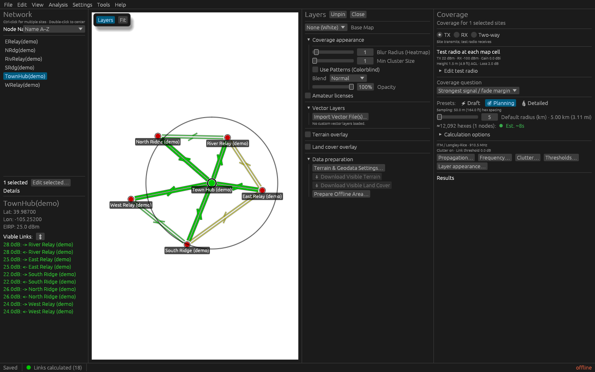
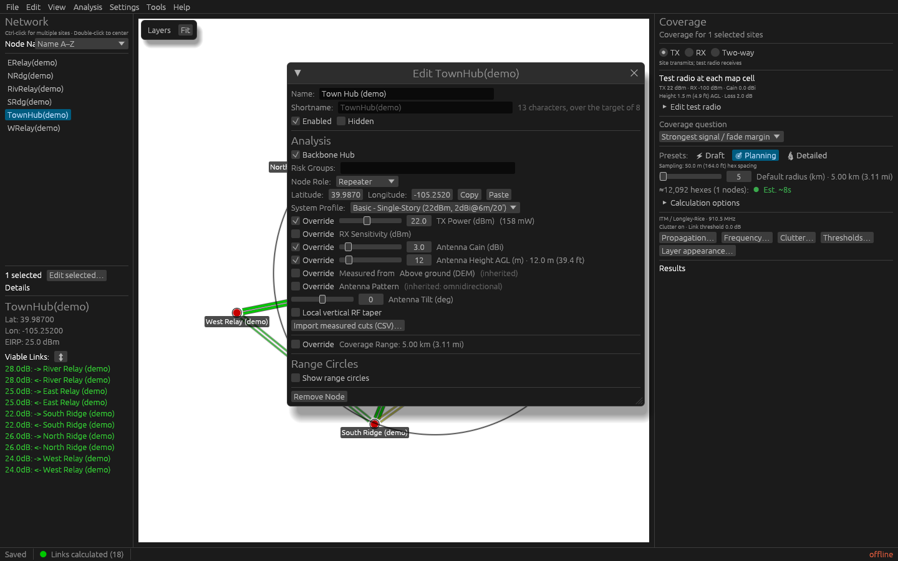

# A visual tour of RidgeCast

These desktop captures were refreshed on October 4, 2026, using the revamped
planning workspace and a synthetic six-site demonstration network. Site names,
positions, and saved link values are illustrative; the colors do not validate
a real RF design. The demonstration uses offline mode and a plain basemap,
with no amateur-license records or calculated coverage overlay.

## Network overview

The map shows named sites, directional links, and the selected hub's range
circle. This circle marks the coverage calculation's evaluation extent;
usable radio coverage must be calculated within it. The left **Network**
navigator keeps the site list, selected-site details, and **Viable Links**
together. Viable Links lists incoming and outgoing links that meet the
**Visible Link Threshold** in Fade Margin Settings. Click a site to select it,
Ctrl-click to select several, or double-click a list row to center the map. Use
**Edit selected…** to change a site's settings.

The right **Coverage** workbench counts eligible selected sites: enabled,
visible radio sites, excluding non-radio markers, plus selected amateur-license
locations. **TX** means a site transmits to the test radio; **RX** means the
test radio transmits to the site; **Two-way** requires both directions from
the same serving site.
**Test radio at each map cell** is the hypothetical radio placed away from
your sites; expand **Edit test radio** to change it. **Coverage question**
chooses what the map answers, such as strongest signal or best serving site,
while **Draft**, **Planning**, and
**Detailed** set calculation detail. Check **Default radius** and the workload
estimate before calculating. The radius limits the evaluation extent; a site
can override the default. **Calculation options** holds the finer controls;
population and coverage results appear below the inputs.

See [Plan your first network](tutorials/plan-your-first-network.md) to start a project, or
[Generate and export coverage](how-to/generate-and-export-coverage.md) to
calculate coverage with your own sites and terrain data.

## Map Layers

Click **Layers** above the map to open the drawer for basemaps, coverage
appearance, terrain, land cover, amateur locations, and vector overlays.
**Pin** reserves space beside the map, as shown here; **Unpin** returns the
drawer to a floating window. **Close** gives the space back to the map.
On a smaller window, a pinned drawer floats temporarily to preserve map space.

The map's **Fit** menu frames sites, their evaluation ranges, or visible
calculated coverage. **Layers → Data preparation** opens terrain settings and
download tools even when the corresponding overlays are hidden.

See [Planning workspace controls](reference/controls-and-shortcuts.md#planning-workspace)
and [Map views](reference/map-views.md) for the complete controls.

## Edit a site

Select a site and choose **Edit selected…** in Network, or double-click its
marker on the map. The editor groups its name and visibility, analysis roles,
coordinates, and radio settings in one window. Choose a shared system profile
for reusable defaults, then override individual values for this site when
needed. Floating windows fit their contents and let you adjust their width;
scrolling appears when a form exceeds the available window height.
**Enabled** and **Hidden** affect calculation eligibility; **Backbone Hub**
marks a root for network-connectivity analysis.

See [Nodes and systems](reference/nodes-and-systems.md) for profile inheritance,
antenna settings, and site overrides.

## Fade Margin Settings

Open **Settings → Fade Margin Settings** to set the visible-link cutoff and
the **Good**, **Fair**, and **Marginal** color thresholds. Fade margin is the
predicted signal level above the effective noise floor, in decibels (dB);
higher values mean more headroom. **Smooth coverage colors** blends colors
between the thresholds; turn it off for distinct bands. The separate
**Best Unit Threshold** sets the minimum margin a site needs to compete to
serve a map cell in Best Unit mode, selected as **Best serving site** under
**Coverage question** when at least two eligible sites are selected.

See [Coverage modes and quality bands](reference/coverage-modes.md) for the
meaning of these settings.

## Radio Systems Manager

Open **Edit → Radio Systems Manager** to manage shared radio and antenna
profiles. The manager lists profiles with transmit power, antenna gain, and
antenna height. Expand a profile to edit its settings, or choose
**Add New System** for another kind of station. Sites assigned to a profile
inherit its defaults unless they override a value in the site editor.

See [Nodes and systems](reference/nodes-and-systems.md) for profile
inheritance and node overrides.
