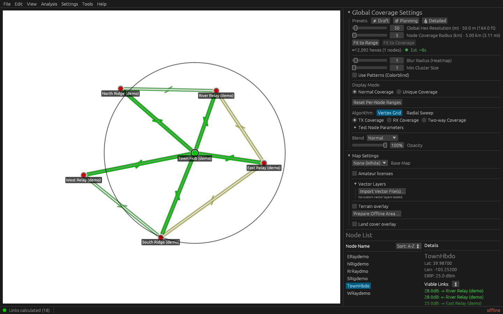
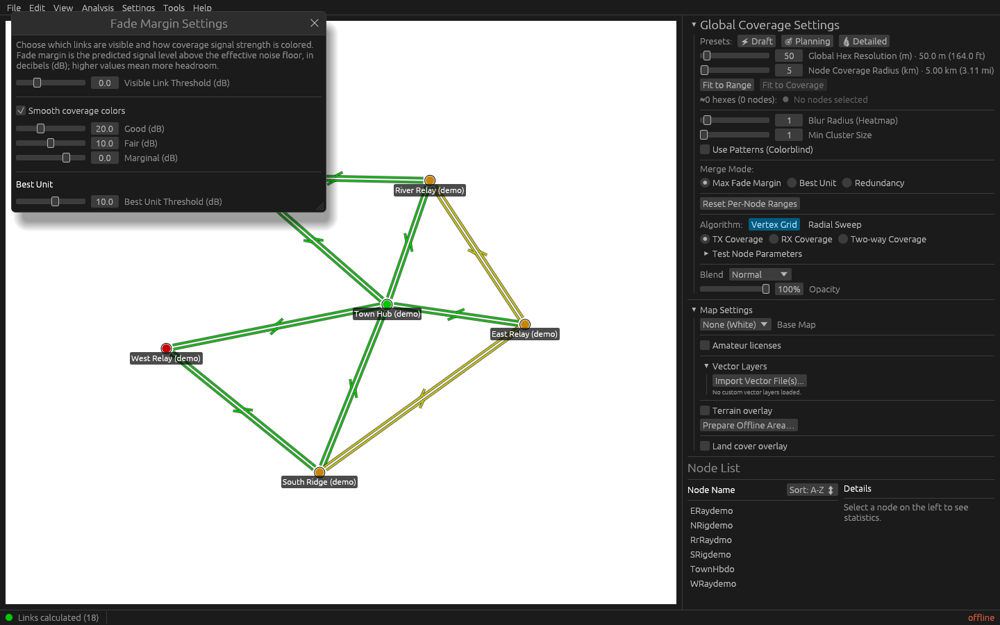
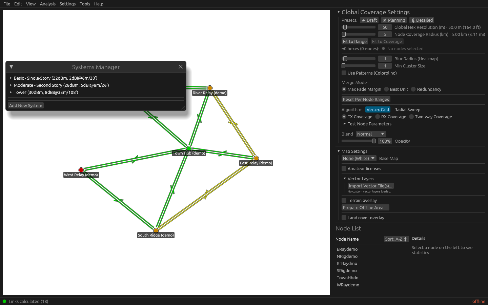

# A visual tour of RidgeCast

These captures show the current desktop interface with a synthetic six-site
demonstration network. Site names, positions, and saved link values are
illustrative; the colors do not validate a real RF design. The demonstration
uses offline mode and a plain basemap, with no amateur-license records.

## Network overview

The map shows named sites, directed links, and the selected hub's range circle.
The right panel brings together coverage settings, map overlays, the node list,
and details for the selected node.

See [Plan your first network](tutorials/plan-your-first-network.md) to start a project, or
[Generate and export coverage](how-to/generate-and-export-coverage.md) to
calculate coverage with your own sites and terrain data.

## Fade Margin Settings

Set the visible-link cutoff and the Good, Fair, and Marginal thresholds. The
smooth-color option controls how coverage colors blend between those
thresholds. The window also exposes the Best Unit threshold.

See [Coverage modes and quality bands](reference/coverage-modes.md) for the
meaning of these settings.

## Radio Systems Manager

System profiles collect shared radio and antenna parameters. The manager lists
the available profiles with transmit power, antenna gain, and antenna height;
expand a profile to edit its settings or add another system for a different
kind of station.

See [Nodes and systems](reference/nodes-and-systems.md) for profile
inheritance and node overrides.
